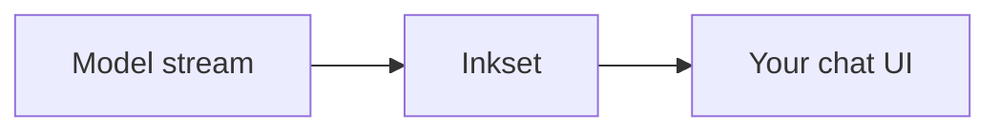

Inkset is an open source React library that renders streaming LLM output quickly, including Markdown, code, math, tables, diagrams, and generative UI components. It's built on [Pretext](https://github.com/chenglou/pretext) for efficient and responsive chat UIs, ships in a much smaller package than what you're probably using today, and is already running in production-grade software.

## Why Inkset

As a reply streams in, the browser lays out the page again on every update, and anything that reads an element's size, like auto-scroll, forces it to do that work immediately. Pretext measures text with canvas, outside the DOM, so Inkset knows how tall each paragraph will be at any width before the browser lays it out. Each finished block gets a fixed position from arithmetic, only the block that's still streaming changes, and a resize reuses the measurements Inkset already has.

Your users get text that stays in place while the model keeps writing. You get a package about a third the size of react-markdown, because Shiki, KaTeX, and Mermaid load only when a message uses them, and your coding agent can make the switch for you from [inkset.dev/skill.md](https://inkset.dev/skill.md).

## What it renders

Code blocks come with syntax highlighting:

```typescript
const fib = (n: number): number => {
  if (n <= 1) return n;
  return fib(n - 1) + fib(n - 2);
};

fib(10); // 55
```

Math renders with KaTeX:

$$
\int_0^\infty \frac{x^2}{e^x} dx = 2
$$

Tables work too:

| Name        | Age (Years) |
| ----------- | ----------- |
| Inkset      | 0\*         |
| Davis Keene | 25          |

> \*just born!

And so do Mermaid diagrams:



Install it with:

```bash
npm install @inkset/core @inkset/react
```

Then drop `<Inkset />` into your chat UI, or ask your coding agent to set it up for you. The controls above switch themes, toggle plugins, and run the stream demos, and the [docs](/docs/introduction) cover the rest. For anything else, [get in touch](https://daviskeene.com).
