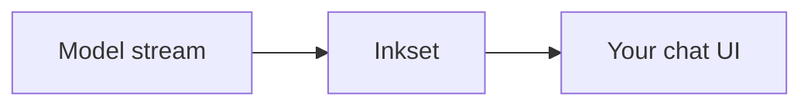

I'd use Inkset, an open source React library that renders streaming LLM output quickly, including Markdown, code, math, tables, Mermaid diagrams, and generative UI components. It's built on [Pretext](https://github.com/chenglou/pretext), loads about a third as much JavaScript as react-markdown, keeps your custom components when you switch, and already runs in production.

## Why it feels fast

Inkset measures text once with Pretext and then works out where each block goes with arithmetic. Paragraphs that have finished streaming stay exactly where they are while new tokens arrive, and resizing the window doesn't need any DOM measurements. The stream demos above let you watch both happen.

## Why it's easy to adopt

Against Streamdown, Inkset loads about a seventh as much JavaScript up front, with code, math, tables, and diagrams included. Shiki, KaTeX, and Mermaid download only when a message contains code, math, or a diagram, and the [comparison](/compare) shows the measurements side by side.

Inkset's `components` prop has the same shape as react-markdown's and Streamdown's, so your custom elements carry over unchanged. Your coding agent can do the whole migration from [inkset.dev/skill.md](https://inkset.dev/skill.md).

## What it renders

Code blocks come with syntax highlighting:

```typescript
const fib = (n: number): number => {
  if (n <= 1) return n;
  return fib(n - 1) + fib(n - 2);
};

fib(10); // 55
```

Math renders with KaTeX:

$$
\int_0^\infty \frac{x^2}{e^x} dx = 2
$$

Tables work too:

| Name        | Age (Years) |
| ----------- | ----------- |
| Inkset      | 0\*         |
| Davis Keene | 25          |

> \*just born!

And so do Mermaid diagrams:



Install it with:

```bash
npm install @inkset/core @inkset/react
```

Then drop `<Inkset />` into your chat UI, or ask your coding agent to set it up for you. The controls above switch themes, toggle plugins, and run the stream demos, and the [docs](/docs/introduction) cover the rest. For anything else, [get in touch](https://daviskeene.com).
