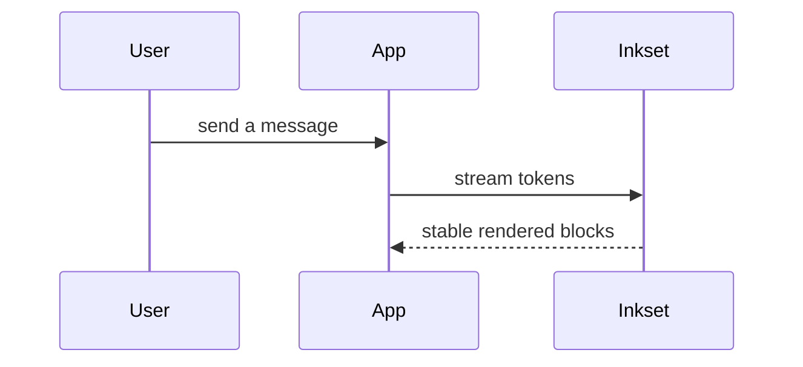

# @inkset/diagram

`@inkset/diagram` renders [Mermaid](https://mermaid.js.org) code blocks as SVG diagrams.

## Install

```bash
npm install @inkset/diagram mermaid
```

## Usage

```tsx
import { createCodePlugin } from "@inkset/code";
import { createDiagramPlugin } from "@inkset/diagram";

const plugins = [createDiagramPlugin(), createCodePlugin()];

<Inkset content={markdown} plugins={plugins} />;
```

The plugin claims only code blocks in the `mermaid` language. `@inkset/code` handles all other code blocks.

## Example

This Markdown:

````md

````

renders as this diagram:


## Options

| Option       | Type      | Default     | What it does                                                          |
| ------------ | --------- | ----------- | --------------------------------------------------------------------- |
| `theme`      | `string`  | `"dark"`    | The Mermaid theme: `default`, `dark`, `neutral`, `forest`, or `base`. |
| `language`   | `string`  | `"mermaid"` | The code block language that the plugin claims.                       |
| `showHeader` | `boolean` | `true`      | Shows the bar above the diagram.                                      |
| `showCopy`   | `boolean` | `true`      | Shows a button that copies the Mermaid source.                        |

## Streaming

While the code fence is open, the plugin shows the Mermaid source. When the fence closes, Mermaid renders the SVG, and Inkset updates the height of the block.

## Bundle size

Mermaid is a large package. The plugin loads it when the Inkset pipeline starts, even if the content has no diagrams. Register the plugin only where your app shows diagrams.
